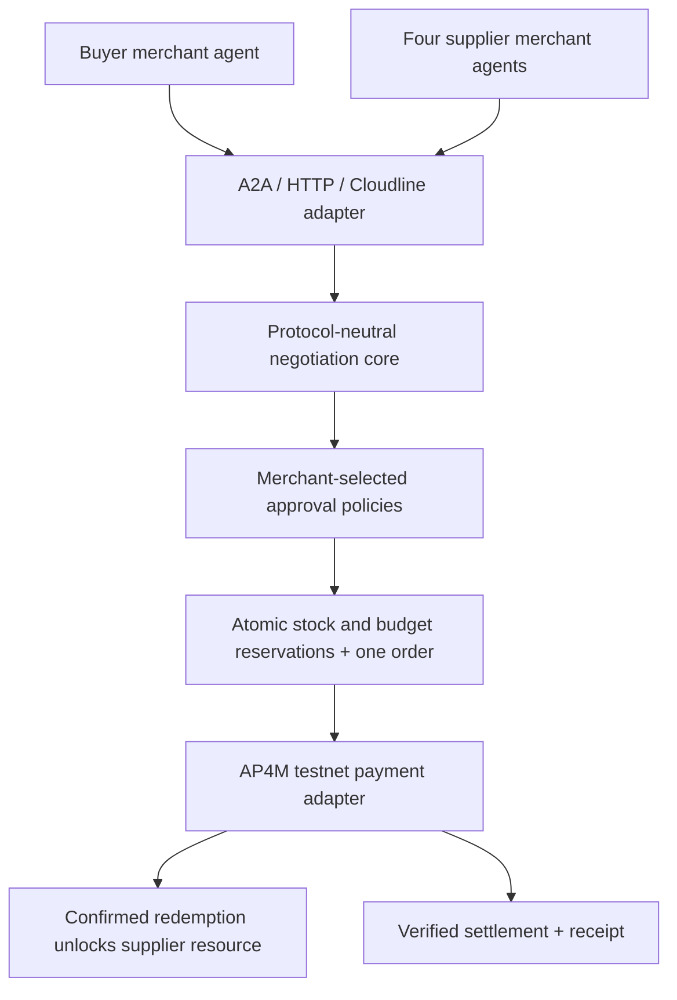

# Agentic Wholesale Commerce — architecture reference

This describes the private XRPay implementation. The public skeleton supplies only the interface boundaries and static fixtures shown in its README.

[Cloudline](https://github.com/cpayX3/cloudline) is an external communication integration used by the private prototype. Its adapter feeds the same negotiation core; merchant approval and payment authority remain enforced by XRPay.

## Authority boundaries

- Each business admits an agent to represent it; transport identity alone does not grant purchasing authority.
- Manual approval requires human review. Delegated approval acts within a mandate. Exceptions-only approval requests human review of configured commercial exceptions. Hard limits remain enforced in every mode.
- Both sides authorize the same revision and terms hash. Incoming agent messages cannot impersonate human approvals or alter private budgets.
- One sourcing request selects one supplier. Commitments reserve stock and budget together, with a durable operation ID for retries.
- AP4M uses RLUSD on XRPL EVM Testnet, chain 1449000. The four fictional suppliers share one explicitly labeled registered demo payout.
- Resource release follows confirmed voucher redemption. Settlement and the supplier token transfer are verified separately before claiming payment completion.

## Deliberately omitted

Authentication, persistence, workers, protocol wire implementations, policy enforcement, cryptographic signing, SDK integration and production application code. Adapter placeholders throw errors; they cannot execute a payment. The local quote illustration is not evidence of live negotiation or settlement.
